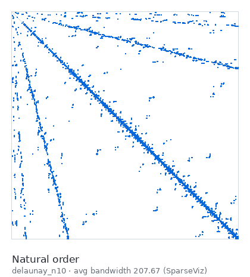

# 👋 Hi, I'm Yiğit Manafi

🎓 **Computer Science & Engineering** student at **Sabancı University** · 📍 Istanbul, Turkey · 📊 GPA **3.84 / 4.00**

I work on **sparse matrices and parallel performance** in academic research projects, and I build tools in **C++** and **Python**.

---

## ⭐ Featured: SparseViz

<table>
<tr>
<td width="56%" valign="top">

**[SparseViz](https://github.com/sparcityeu/SparseViz)** is an open-source C++ library that reorders sparse matrices and tensors, draws them, and times CPU/GPU kernels on every ordering.

**What I did**

- 📊 Added **new metrics** to SparseViz's report: wavefront, insularity, x-vector reuse distance, row/column entropy, BFS-based ordering quality, compactness and block analysis. New comparison sections rank the orderings and check each metric against the measured kernel time (Spearman correlation, sensitivity, redundancy). [See them in the guide](https://sparcityeu.github.io/SparseViz/guide/#metrics).
- 🐛 Bug-fix pull requests for the core library: build paths, matrix / tensor / IO fixes, and keeping local matrices ([#6](https://github.com/sparcityeu/SparseViz/pull/6), [#7](https://github.com/sparcityeu/SparseViz/pull/7), [#8](https://github.com/sparcityeu/SparseViz/pull/8)).
- 📈 Cache-locality analysis: a cache hit plot and features for every matrix and ordering ([#9](https://github.com/sparcityeu/SparseViz/pull/9)).
- 🖥️ Ran and measured everything on an HPC cluster (OpenMP, Slurm, NUMA-aware thread counts).
- 🌐 Built the **[interactive guide website](https://sparcityeu.github.io/SparseViz/guide/)**: how to build, configure, run and extend SparseViz, with animations made from real SparseViz runs ([#10](https://github.com/sparcityeu/SparseViz/pull/10)).

On a matrix with 1 million rows, the RCM ordering made SparseViz's SpMV kernel **3.3× faster** on one thread (31.7 ms → 9.6 ms).

**[→ Open the guide](https://sparcityeu.github.io/SparseViz/guide/)**

</td>
<td width="44%" valign="top" align="center">

<a href="https://sparcityeu.github.io/SparseViz/guide/">
  <picture>
    <source media="(prefers-color-scheme: dark)" srcset="assets/sparseviz-rcm-dark.gif">
    
  </picture>
</a>

Real SparseViz output: the same matrix before and after RCM reordering.

</td>
</tr>
</table>

---

## 🚀 Other Projects

| Project | Language |
|---|---|
| 💰 [Salary Filter Analyzer](https://gist.github.com/yigitmnf/afb6b26bd1c739051f90217840957732) | Python |
| 📘 [Book Reading Scheduler](https://gist.github.com/yigitmnf/1a43c91b12ac87a2a4d6f59e4c11de6c) | Python |
| 🏫 [University Library System](https://gist.github.com/yigitmnf/df29c9c0d19d641ef1df178237282030) | C++ |
| 📇 [Contact Book System](https://gist.github.com/yigitmnf/2c5b04247b1b61861cbd01d758c4bbc8) | C++ |
| 🎮 [Game Machine](https://gist.github.com/yigitmnf/5ced43b9dd455f31cce491038e2935d3) | Verilog |
| 🎯 [FPGA Guess Game](https://gist.github.com/yigitmnf/8b37f1fb35b923602d2f8d9dd8eb5172) | Verilog |

---

## 🧪 Teaching & Academic Roles

- **Teaching Assistant** – Introduction to Python (Sabancı University Summer High School Program)
- **Teaching Assistant** – Quantum Physics (Sabancı University Summer High School Program)
- **Peer Moderator** – Calculus I–II, Natural Sciences I–II *(Sabancı University Academic Support Program)*

## 🏭 Industry Experience

**Intern – TÜBİTAK BİLGEM YİTAL** · Processor Manufacturing & Semiconductor Technologies
Photolithography · Ion implantation · IC fabrication processes

## 🛠️ Skills

- **Languages:** C++, Python, Verilog
- **Parallel & HPC:** OpenMP, Slurm, Linux clusters
- **Tools:** Git / GitHub, CMake, LaTeX (Overleaf), LTspice
- 🌍 **English:** C1 (Advanced)

## 📫 Contact

📧 yigit.manafi@sabanciuniv.edu · 💼 [LinkedIn](https://www.linkedin.com/in/yigit-manafi-270745217/) · 📄 [CV](https://drive.google.com/drive/folders/1mnerJ6PkpifUpn3CWkO_pwTN_zCaACoa?usp=sharing)
